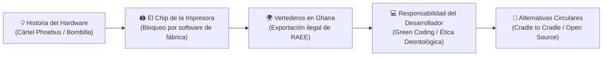
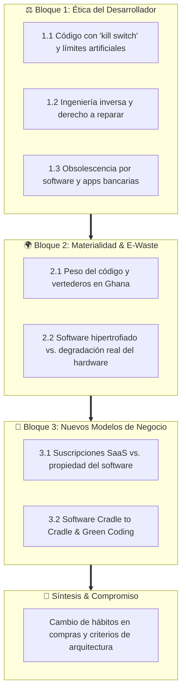

# 11 · Material complementario: Debate sobre Obsolescencia y Ética Profesional

Transversal · RA2 · RA4 · RA5
Ética del Programador
DAW · DAM · ASIR
E-Waste & Derecho a Reparar
Economía Circular

**Módulo:** Sostenibilidad aplicada al sistema productivo (1708)  
**Destinatarios:** Estudiantes de ciclos superiores de Desarrollo de Aplicaciones Web (DAW) y Desarrollo de Aplicaciones Multiplataforma (DAM)  
**Recurso audiovisual:** Documental *«Comprar, tirar, comprar»* (*The Light Bulb Conspiracy*)  
**Duración del vídeo:** 52 minutos · **Duración de la sesión de debate:** 1–2 horas lectivas  

!!! tip "Propósito pedagógico para futuros programadores"
    Este documental constituye una de las herramientas más potentes para remover conciencias en el aula de informática. Aunque arranca con la historia industrial clásica del hardware (bombillas, medias de nylon, impresoras), su valor crítico para estudiantes de **DAW y DAM** reside en **trasladar el debate al software**: el código que escribimos, las dependencias que incorporamos, las decisiones de arquitectura y las limitaciones deliberadas que las empresas pueden exigirnos implementar en productos digitales.

  

    
52 min

    
Duración del documental

  

  

    
3 Bloques

    
Ejes temáticos de debate

  

  

    
RA2 · 4 · 5

    
Resultados de aprendizaje clave

  

  

    
100%

    
Enfoque software & deontología

  

---

## 1. Ficha técnica y acceso al recurso audiovisual

| Parámetro | Detalle técnico |
|---|---|
| **Título original** | *Comprar, tirar, comprar: La historia secreta de la obsolescencia programada* (*The Light Bulb Conspiracy*) |
| **Dirección y Guion** | Cosima Dannoritzer |
| **Producción** | Media 3.14, Televisión Española (RTVE), Arte France, Televisió de Catalunya |
| **Premios** | Mejor Documental en el Festival de Cine de Roma, Prix Europa, Finalista en los Premios Magnolia |
| **Enlace de visualización** | [Ver documental en YouTube (Enlace oficial)](https://www.youtube.com/watch?v=fzwT1GGY0Ds) |
| **Conexión curricular** | ==RA2== (Retos ambientales y RAEE en el Sur Global), ==RA4== (Límites del modelo lineal, ecodiseño y *Cradle to Cradle*), ==RA5== (Marco regulador del residuo electrónico, Derecho a Reparar y buenas prácticas en TI). |

---

## 2. Línea de tiempo y momentos clave del documental

Para facilitar el seguimiento o la preparación previa de los alumnos, se destacan los hitos fundamentales del documental con sus respectivas marcas temporales y su traslación inmediata al ámbito informático:

| Minutaje | Hito en el documental | Conexión con el desarrollo de software (DAW / DAM) |
|:---:|:---|:---|
| [**06:29**](https://www.youtube.com/watch?v=fzwT1GGY0Ds&t=389) | **El cártel Phoebus (1924):** Fabricantes de bombillas pactan reducir la vida útil de 2.500 h a 1.000 h multando a quien incumpla. | Acuerdos tácitos o estándares cerrados entre gigantes tecnológicos para limitar la interoperabilidad y forzar renovaciones de ecosistema. |
| [**14:59**](https://www.youtube.com/watch?v=fzwT1GGY0Ds&t=899) | **Bernard London y la Gran Depresión:** Propuesta de "obsolescencia obligatoria" por ley para salvar la economía y crear empleo continuo. | Modelos de suscripción forzosa (*SaaS*) donde el usuario nunca posee el software y depende de actualizaciones continuas de pago. |
| [**25:43**](https://www.youtube.com/watch?v=fzwT1GGY0Ds&t=1543) | **La impresora de Marcos:** La máquina se detiene mostrando error de servicio técnico debido a un chip contador EEPROM programado para bloquearla. | **El dilema del programador:** Un desarrollador escribió el algoritmo del contador y la llamada al bloqueo de fábrica. |
| [**26:46**](https://www.youtube.com/watch?v=fzwT1GGY0Ds&t=1606) | **El nylon de DuPont:** Fibras ultrarresistentes que son debilitadas deliberadamente en el laboratorio químico para asegurar compras periódicas. | Código inflado (*bloatware*) y desoptimización de aplicaciones que fuerzan la obsolescencia percibida del dispositivo cliente. |
| [**38:13**](https://www.youtube.com/watch?v=fzwT1GGY0Ds&t=2293) | **Agbogbloshie (Acra, Ghana):** Vertederos de residuos electrónicos tóxicos camuflados fraudulentamente como "bienes de segunda mano". | La huella física invisible de la nube y del software: el hardware que jubilamos acaba contaminando comunidades vulnerables del Sur Global. |
| [**43:04**](https://www.youtube.com/watch?v=fzwT1GGY0Ds&t=2584) | **El freeware ruso de rescate:** Marcos contacta con un desarrollador que diseñó una utilidad para resetear el chip contador y revivir la impresora. | El software libre, la ingeniería inversa y el movimiento del *Derecho a Reparar* como contrapeso ético frente al bloqueo corporativo. |
| [**46:05**](https://www.youtube.com/watch?v=fzwT1GGY0Ds&t=2765) | **Filosofía Cradle to Cradle (C2C):** Michael Braungart propone rediseñar los productos para que no existan residuos y todo sea nutriente técnico o biológico. | Arquitecturas de software sostenibles: código reutilizable, modular, retrocompatible, desacoplado y optimizado en consumo de CPU/RAM. |
| [**48:29**](https://www.youtube.com/watch?v=fzwT1GGY0Ds&t=2909) | **La teoría del decrecimiento:** Serge Latouche expone la imposibilidad matemática del crecimiento ilimitado en un planeta finito. | Cuestionamiento del modelo de consumo digital compulsivo: ¿necesitamos rehacer todas las interfaces y librerías cada 18 meses? |

---

## 3. Batería de cuestiones para el debate en clase

A continuación se detalla la batería de preguntas organizada en tres bloques temáticos fundamentales, orientados a situar al estudiante de informática en el centro de la toma de decisiones profesionales.

!!! info "Mapa temático de preguntas del debate pedagógico"
    === "⚖️ Bloque 1: Ética Profesional"
        * **1.1 El papel del desarrollador:** ¿Qué dilema ético plantea programar un *kill switch* o una limitación artificial exigida por la empresa?
        * **1.2 El «hackeo» ético y el derecho a reparar:** Legitimidad de usar ingeniería inversa y herramientas de terceros frente a bloqueos del fabricante.
        * **1.3 Obsolescencia programada por software:** Retirada de soporte en apps críticas, apps bancarias y actualizaciones que ralentizan el terminal.

    === "🌍 Bloque 2: Materialidad y E-Waste"
        * **2.1 El peso del código:** La huella material del software ineficiente y su vínculo causal con los vertederos del Sur Global (Ghana).
        * **2.2 El coste invisible:** Renovación de hardware en aulas y empresas: ¿silicio degradado o software desbordado e hipertrofiado?

    === "🔄 Bloque 3: Modelos y Alternativas"
        * **3.1 Modelos de suscripción SaaS vs. propiedad:** De la obsolescencia obligatoria de Bernard London al pago mensual perpetuo en la nube.
        * **3.2 Filosofía «Cradle to Cradle» en informática:** Principios de residuo cero en software: Green Coding, código abierto, retrocompatibilidad y modularidad.

    === "🎯 Cierre Reflexivo"
        * **Compromiso y cambio de hábitos:** Transformación de criterios al comprar hardware y decisiones de arquitectura en futuros proyectos de código.

---

### Bloque 1: El dilema del programador y la ética profesional

En el documental observamos cómo el fallo de la impresora de Marcos no responde a una rotura mecánica accidental, sino a un chip con un software contador de impresiones diseñado expresamente para bloquearla de fábrica ([25:43](https://www.youtube.com/watch?v=fzwT1GGY0Ds&t=1543)).

??? question "1.1 El papel del desarrollador: ¿Quién programa la obsolescencia?"
    **Contexto:** Ese código contador no se escribió solo; lo ideó y programó un equipo de ingenieros e informáticos.  
    **Pregunta para debate:**  
    *Como futuros desarrolladores en una consultora o empresa de producto, ¿qué dilema ético os plantearía si vuestro responsable de producto os pide programar una limitación artificial, una degradación programada de rendimiento o un «kill switch» en el software para forzar a los usuarios a actualizarse o comprar una versión superior?*  
    *¿Dónde acaba la obediencia laboral a la empresa y dónde empieza la responsabilidad deontológica profesional del programador?*

??? question "1.2 El «hackeo» ético y el derecho a reparar"
    **Contexto:** Para solucionar su bloqueo, Marcos recurre a un freeware desarrollado en Rusia que resetea el contador EEPROM ([43:04](https://www.youtube.com/watch?v=fzwT1GGY0Ds&t=2584)), esquivando la restricción impuesta por el fabricante.  
    **Pregunta para debate:**  
    *¿Creéis que es legítimo que los usuarios y técnicos independientes utilicen ingeniería inversa, firmware alternativo o parches de software de terceros para saltarse las restricciones de un producto que ya han adquirido legalmente?*  
    *¿Debe la ley proteger el derecho del usuario a modificar el software interno de sus dispositivos (como impresoras, tractores o smartphones) o debe prevalecer la propiedad intelectual del fabricante?*

??? question "1.3 La obsolescencia del software en la actualidad"
    **Contexto:** Hoy en día, la obsolescencia ya no es exclusivamente física (como el hilo de nylon debilitado [[26:46](https://www.youtube.com/watch?v=fzwT1GGY0Ds&t=1606)] o las bombillas del cártel Phoebus [[06:29](https://www.youtube.com/watch?v=fzwT1GGY0Ds&t=389)]).  
    **Pregunta para debate:**  
    *¿Qué ejemplos cotidianos conocéis de «obsolescencia programada por software»?*  
    *Algunos ejemplos habituales:*  
    - Aplicaciones bancarias que dejan de admitir versiones de Android o iOS de hace 4 años, dejando el terminal inservible para el usuario.  
    - Actualizaciones de sistema operativo que saturan la memoria RAM o degradan la CPU de terminales antiguos.  
    - Cierre de servidores de autenticación para videojuegos o dispositivos domóticos que convierten el aparato en un «ladrillo» (*bricking*).  
    *¿Dónde está la frontera legítima entre una necesidad técnica real por motivos de ciberseguridad y una estrategia comercial deliberada para forzar el recambio?*

---

### Bloque 2: Impacto ambiental y materialidad de lo digital

El documental documenta cómo millones de toneladas de residuos electrónicos del mundo occidental acaban arrojados en vertederos incontrolados de países en desarrollo como Ghana ([38:13](https://www.youtube.com/watch?v=fzwT1GGY0Ds&t=2293)), burlando convenios internacionales bajo la etiqueta de "material de segunda mano para ayuda al desarrollo".

??? question "2.1 El peso del código: La huella material del software ineficiente"
    **Contexto:** Existe la creencia generalizada de que el desarrollo de software es una actividad "limpia" porque ocurre "en la nube" y no genera humos visibles. Sin embargo, el código ineficiente ejerce una demanda directa sobre el hardware físico.  
    **Pregunta para debate:**  
    *Si como programadores web (DAW) o móviles (DAM) desarrollamos aplicaciones mal optimizadas, hipertrofiadas con decenas de librerías innecesarias o que consumen cantidades masivas de memoria y batería, ¿estamos empujando indirectamente al usuario a desechar su teléfono o portátil antes de tiempo?*  
    *¿Somos los desarrolladores corresponsables de la basura electrónica que se acumula en Agbogbloshie y otros vertederos del planeta?*

??? question "2.2 El coste invisible: ¿Hardware desgastado o software desbordado?"
    **Contexto:** En institutos, universidades, administraciones públicas y empresas es muy habitual renovar parques enteros de ordenadores porque "van lentos" o "ya no pueden con el sistema".  
    **Pregunta para debate:**  
    *Cuando un centro de trabajo retira ordenadores de hace 7 años porque no responden adecuadamente, ¿el problema principal es el desgaste físico de sus componentes electrónicos (silicio, cobre, condensadores) o la exigencia desmedida de frameworks, sistemas operativos y aplicaciones web modernas frente a las de hace una década?*  
    *¿Qué papel juega la falta de optimización algorítmica y el desprecio a la retrocompatibilidad en esta espiral de residuos?*

---

### Bloque 3: Economía, consumo y alternativas

El documental contrapone las tesis del crecimiento ilimitado impulsado por el consumo forzoso frente a corrientes críticas como la teoría del decrecimiento de Serge Latouche ([48:29](https://www.youtube.com/watch?v=fzwT1GGY0Ds&t=2909)) o el diseño circular regenerativo.

??? question "3.1 Modelos de negocio sostenibles: ¿Es el SaaS una solución o un consumo perpetuo?"
    **Contexto:** En los años 30, Bernard London propuso hacer obligatoria por ley la caducidad de los productos para sostener el empleo fabril ([14:59](https://www.youtube.com/watch?v=fzwT1GGY0Ds&t=899)). En la actualidad, la industria del software ha mutado hacia el modelo de **Suscripción o Software as a Service (SaaS)**, tanto en suites ofimáticas (Microsoft 365, Adobe Creative Cloud) como en streaming y videojuegos.  
    **Pregunta para debate:**  
    *El modelo SaaS, donde el cliente nunca posee el software sino que paga una cuota mensual perpetua, ¿es una alternativa más ecológica (al no fabricar cajas ni discos físicos) o constituye una forma moderna de dependencia económica y consumo perpetuo donde el usuario pierde el control sobre sus herramientas de trabajo?*

??? question "3.2 Filosofía «Cradle to Cradle» (De la cuna a la cuna) aplicada a la informática"
    **Contexto:** Michael Braungart propone en el documental rediseñar los procesos productivos para imitar a la naturaleza: un modelo donde el concepto de «residuo» desaparece y todo producto se concibe como nutriente de la siguiente generación ([46:05](https://www.youtube.com/watch?v=fzwT1GGY0Ds&t=2765)).  
    **Pregunta para debate:**  
    *Si trasladamos el paradigma «Cradle to Cradle» al desarrollo de software y sistemas, ¿cómo sería una aplicación informática verdaderamente C2C?*  
    *Ideas clave para guiar la reflexión en el aula:*  
    - **Código Abierto y Libre:** Permite que la comunidad mantenga y repare el software cuando la empresa matriz quiebre o abandone el soporte.  
    - **APIs y protocolos retrocompatibles:** Evitan romper clientes y servicios antiguos ante cambios de versión.  
    - **Arquitecturas modulares:** Sustituir o actualizar módulos concretos sin necesidad de reescribir ni desplegar toda la aplicación desde cero.  
    - **Green Coding:** Ecodiseño de algoritmos que minimicen el uso de ciclos de reloj de CPU y transferencias de red innecesarias.

---

### Dinámica de cierre: Compromiso y cambio de hábitos

!!! quote "Pregunta final de síntesis para el aula"
    *"Tras haber visto el documental y analizado la cara oculta de la industria tecnológica:*  
    *1. ¿Cambiarías algún hábito personal de consumo a la hora de adquirir tu próximo portátil, teléfono móvil o servidor personal? (¿Buscarías marcas con alto índice de reparabilidad, comprarías reacondicionado, alargarías su vida útil cambiando tú mismo la pasta térmica o la batería?)*  
    *2. A nivel profesional, ¿de qué manera influirá lo aprendido a la hora de diseñar la arquitectura, elegir las tecnologías y optimizar el código de vuestro próximo proyecto de programación?"*

---

## 4. Guía didáctica y propuesta metodológica de aula

Para el profesorado que dinamice esta actividad en el módulo de Sostenibilidad, se sugieren las siguientes pautas organizativas:

=== "📋 Metodología: Clase Invertida (Flipped Classroom)"
    1. **Fase previa (en casa):** Los estudiantes visualizan el documental completo (52 min) utilizando la ficha técnica y la línea de tiempo proporcionada.
    2. **Fase de aula (1 sesión de 50-60 min):**
        - **Introducción (10 min):** Breve sondeo de impresiones generales y votación rápida en pizarra sobre si la obsolescencia programada es un delito o un motor económico.
        - **Debate en grupos (25 min):** Se divide la clase en 3 grandes grupos de trabajo, asignando a cada uno de ellos uno de los bloques de preguntas (Bloque 1: Ética del programador; Bloque 2: Impacto ambiental; Bloque 3: Modelos económicos).
        - **Puesta en común y conclusiones (20 min):** Un portavoz por grupo expone los acuerdos y discrepancias de su bloque, cerrando con la pregunta de reflexión individual.

=== "⚖️ Formato alternativo: Debate Oxford (Roles cruzados)"
    Se plantea una moción formal en el aula:  
    *«Esta asamblea considera que programar obsolescencia en software o limitar el derecho a reparar debería tipificarse como delito contra el medio ambiente y los consumidores.»*
    - **Equipo a favor:** Defiende el derecho a reparar, la responsabilidad penal del fabricante, el código abierto y la protección de los vertederos del Sur Global.
    - **Equipo en contra:** Defiende la libertad de empresa, la ciberseguridad indispensable, la necesidad de financiar la I+D mediante ciclos continuos de renovación y la inviabilidad económica de mantener el software para siempre.

=== "📊 Rúbrica formativa de participación en el debate"
    | Criterio | Nivel 1 (Insuficiente) | Nivel 2 (Aceptable) | Nivel 3 (Excelente) |
    |---|---|---|---|
    | **Argumentación técnica (RA2 / RA4)** | Opiniones personales sin datos ni referencias al documental. | Conecta sus argumentos con ejemplos del documental o del sector TIC. | Vincula con rigor la obsolescencia con conceptos clave (EEPROM, RAEE, Green Coding, C2C, LCA). |
    | **Enfoque profesional informático** | Se limita al hardware sin profundizar en el software. | Plantea dilemas sobre aplicaciones y apps móviles. | Analiza con madurez el papel ético del programador y las consecuencias del código ineficiente. |
    | **Respeto y debate constructivo** | Interrumpe o no escucha al resto de compañeros. | Respeta los turnos y formula réplicas educadas. | Construye sobre las ideas de otros, formula preguntas retóricas y busca consensos sostenibles. |

---

## 5. Recursos complementarios y lecturas recomendadas

- **Green Software Foundation:** [greensoftware.foundation](https://greensoftware.foundation) — Estándares internacionales de ingeniería de software sostenible y especificación *Software Carbon Intensity* (SCI).
- **Iniciativa Europea por el Derecho a Reparar:** [repair.eu](https://repair.eu) — Campaña comunitaria para legislar la disponibilidad de repuestos, documentación y actualizaciones de software libres de bloqueos.
- **iFixit Smartphone & Laptop Repairability:** [es.ifixit.com](https://es.ifixit.com) — Guías de desmontaje, índice de reparabilidad y denuncias públicas de chips y pegamentos que bloquean la reparación independiente.
- **The Restart Project:** [therestartproject.org](https://therestartproject.org) — Red internacional de talleres ciudadanos de reparación comunitaria de dispositivos electrónicos contra la cultura del usar y tirar.
- **Software Heritage:** [softwareheritage.org](https://www.softwareheritage.org) — Archivo global universal para preservar el código fuente del software como patrimonio cultural y bien común de la humanidad.
